

<a href="https://covermelienservices.com">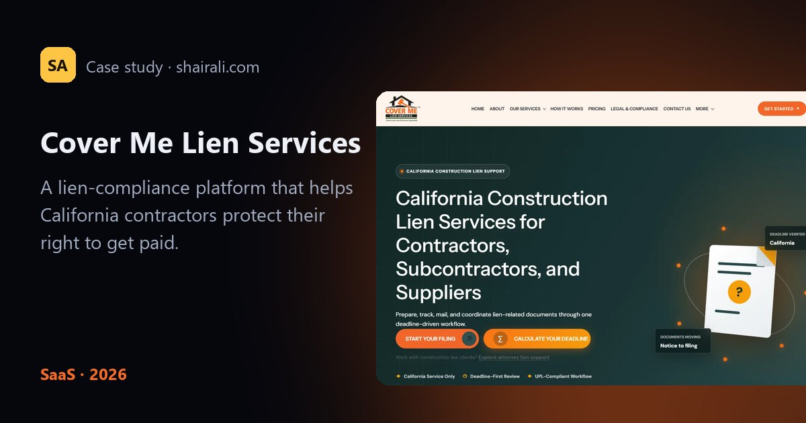</a>

# Cover Me Lien Services

**A lien-compliance platform that helps California contractors protect their right to get paid.**

 

SaaS · CoverM Enterprise, LLC · California, USA · Mar 2026 – Oct 2026

> [!NOTE]
> This repository is a **showcase**. The source code is private and belongs to the client, so this page documents what I built, how it works and the stack behind it. Screenshots are from the live product.

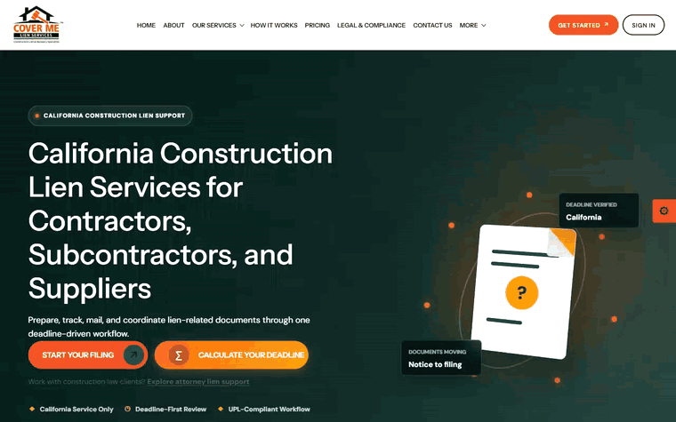

## Overview

Construction-lien document preparation and deadline tracking for contractors, subcontractors, suppliers and law firms, with online intake, payments, a client portal and an admin back office.

| | |
|---|---|
| **Role** | Solo full-stack developer: UX, frontend, backend, infrastructure & DevOps |
| **Client** | CoverM Enterprise, LLC · California, USA |
| **Timeline** | Mar 2026 – Oct 2026 |
| **Live** | [covermelienservices.com](https://covermelienservices.com) |

## At a glance

<table><tr>
<td align="center" width="25%"><h3>~40</h3>API endpoints</td>
<td align="center" width="25%"><h3>9</h3>Data models</td>
<td align="center" width="25%"><h3>13</h3>Automated email flows</td>
<td align="center" width="25%"><h3>7 mo</h3>Concept to production</td>
</tr></table>

## The challenge

In California construction, one missed statutory deadline can cost a contractor their lien rights, and the payment that comes with them. The client was taking orders by phone and email, working out deadlines by hand and chasing documents across inboxes. They needed a compliant self-service platform that could quote, take payment and collect documents, and give their team one place to run every case.

## What I built

I designed and built the whole product. It has a Next.js marketing site with California lien-law resources and a free deadline calculator, plus a multi-step intake with server-side pricing and Stripe Checkout. Clients get a secure portal for uploads and requests, and the team gets an admin back office to run each case. It's all deployed on a hardened Linux server with automated CI/CD.

## Key features

### Free deadline calculator

Five quick questions give state-specific lien deadlines in under a minute. The engine applies the earliest rule that matches and skips weekends. It's also the site's strongest lead magnet.

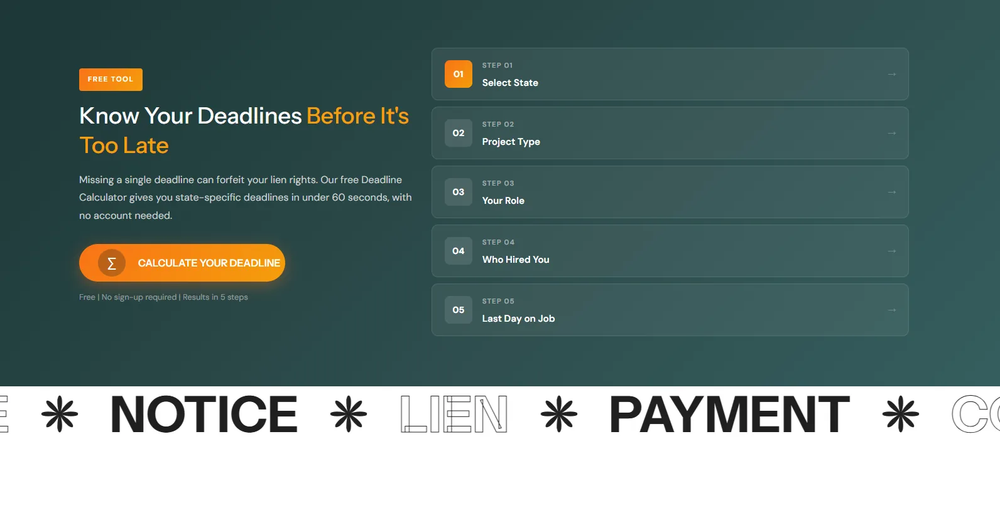

### Guided intake and Stripe checkout

A three-step intake covers the request, the project and the signature. Pricing is calculated on the server (self-service vs full-service, plus a rush option) and paid through Stripe Checkout with signed, idempotent webhooks. Clients can resume an unpaid request at any time.

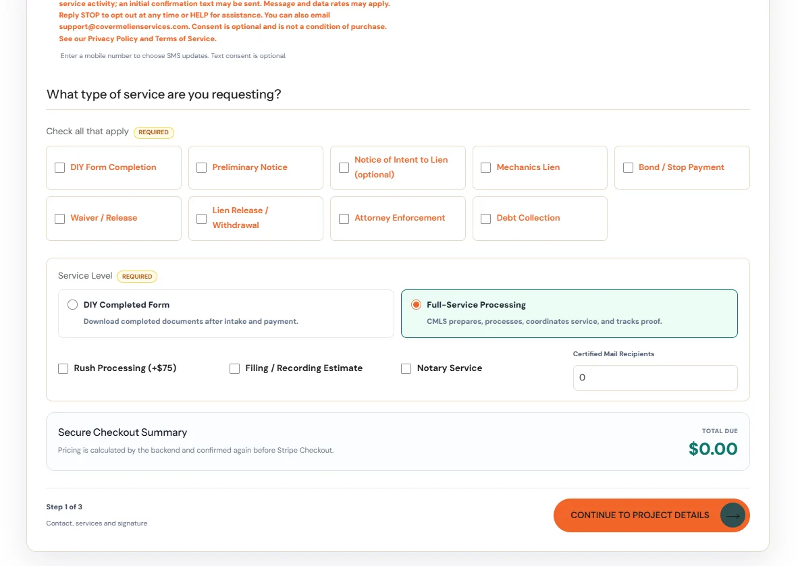

### Secure client portal

Clients track every request, answer document and signature requests, and upload files straight to private, encrypted storage through presigned URLs. Each upload is checked with a checksum and verified by its file signature.

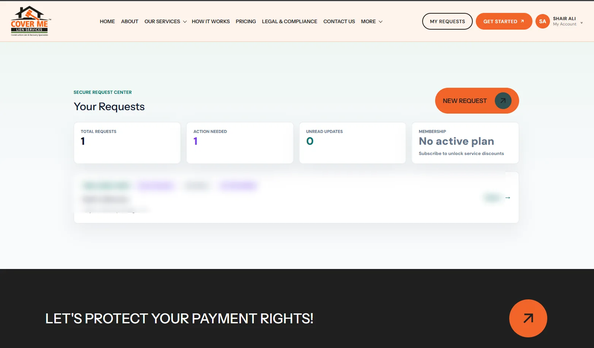

### Attorney partner programme

A dedicated area for construction-law firms, with partnership packages and an inquiry pipeline, so attorneys can outsource lien paperwork with confidence.

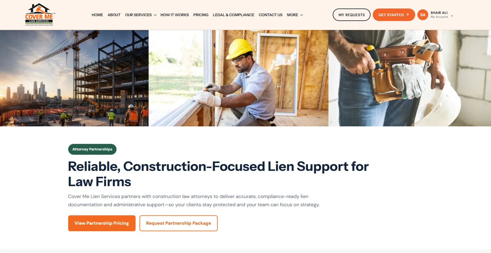

## Architecture

```mermaid
flowchart LR
  subgraph L0["Client"]
    direction TB
    L0_0["Browser"]
    L0_1["Cloudflare DNS, proxy & Turnstile"]
  end
  subgraph L1["Edge"]
    direction TB
    L1_0["Nginx reverse proxy"]
    L1_1["Let's Encrypt TLS"]
  end
  subgraph L2["Application"]
    direction TB
    L2_0["Next.js 15 (SSR)"]
    L2_1["Express API /api/v1"]
    L2_2["PDF document worker"]
    L2_3["PM2"]
  end
  subgraph L3["Data & services"]
    direction TB
    L3_0["MongoDB Atlas"]
    L3_1["Private S3-compatible storage"]
    L3_2["Stripe Checkout"]
    L3_3["Resend email"]
    L3_4["AWS SQS"]
  end
  L0 --> L1
  L1 --> L2
  L2 --> L3
```

## Engineering highlights

- JWT in httpOnly cookies with role-based access for clients and admins.
- Per-route rate limits, NoSQL-injection and HTTP parameter pollution protection, and an exact-match CORS allowlist.
- Uploads are SHA-256 checksummed and verified by file signature (magic bytes). Downloads use 60-second signed URLs, issued only after an ownership check.
- Stripe webhooks are signature-verified and deduplicated through a stored event log.
- SMS consent is stored separately from service terms, with a full audit history, and the site carries clear legal disclaimers that it is not a law firm (UPL compliance).
- SEO: canonical URLs, Open Graph, JSON-LD and a generated sitemap. The CI/CD pipeline checks environment values before every deploy.

## Tech stack

| Area | Technologies |
|---|---|
| **Frontend** |      |
| **Backend** |      |
| **Data** |     |
| **Integrations** |    |
| **Infrastructure** |       |

## Screens

<table>
<tr>
<td width="50%" valign="top">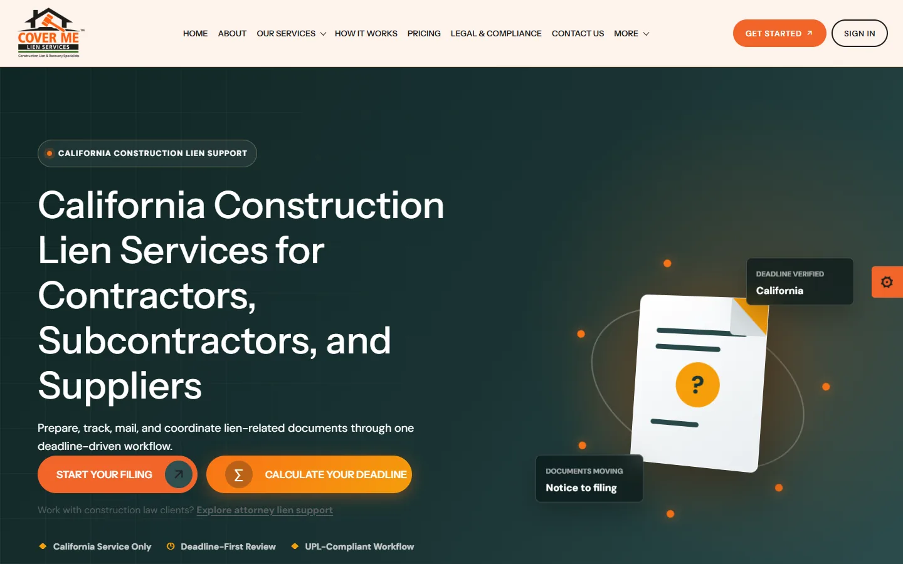 Homepage: California construction lien services</td>
<td width="50%" valign="top">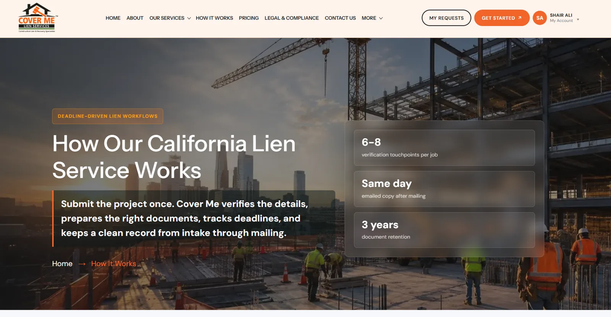 How it works: deadline-driven lien workflows</td>
</tr>
<tr>
<td width="50%" valign="top">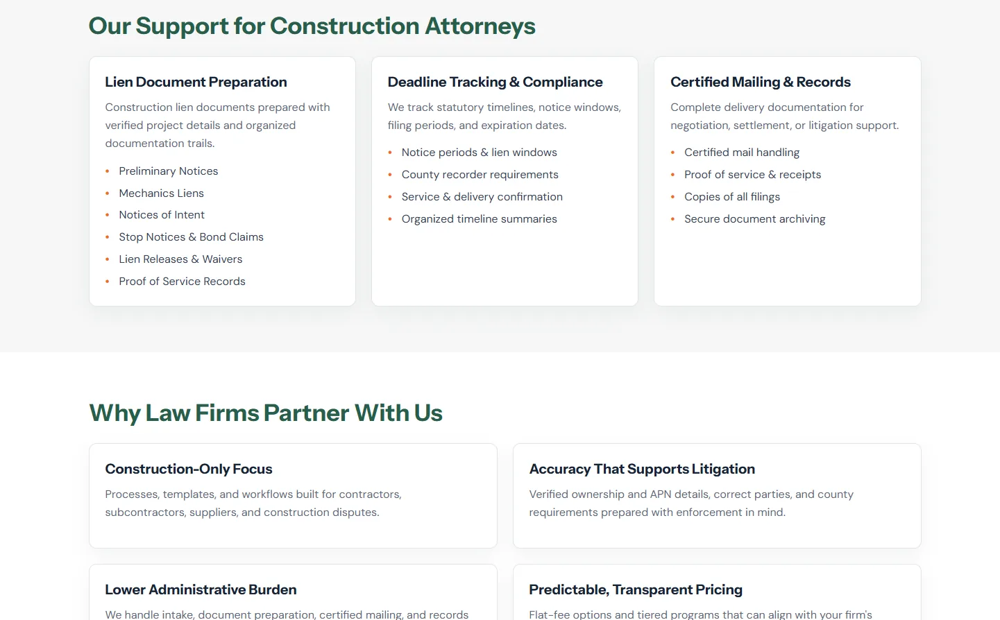 Support services for construction attorneys</td>
<td width="50%" valign="top">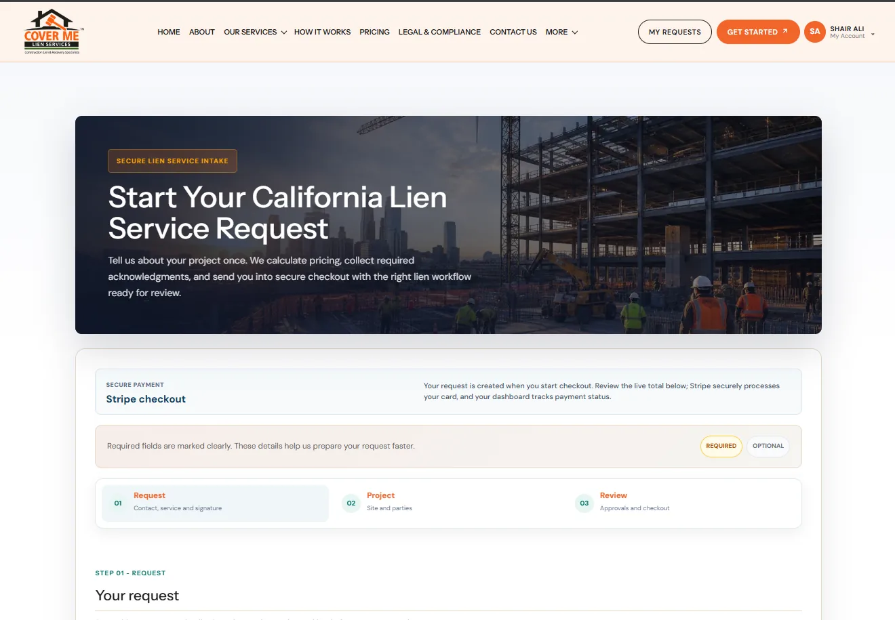 Start a California lien service request</td>
</tr>
<tr>
<td width="50%" valign="top">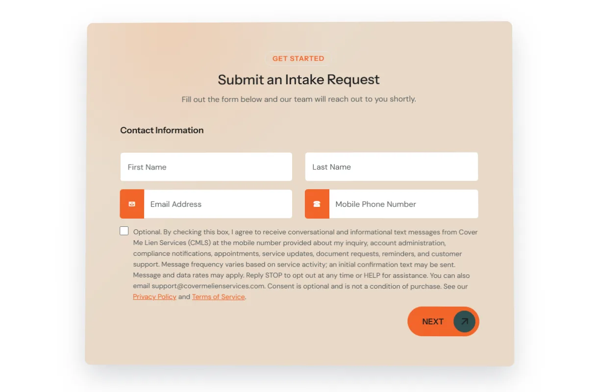 Intake request contact form</td>
<td width="50%" valign="top">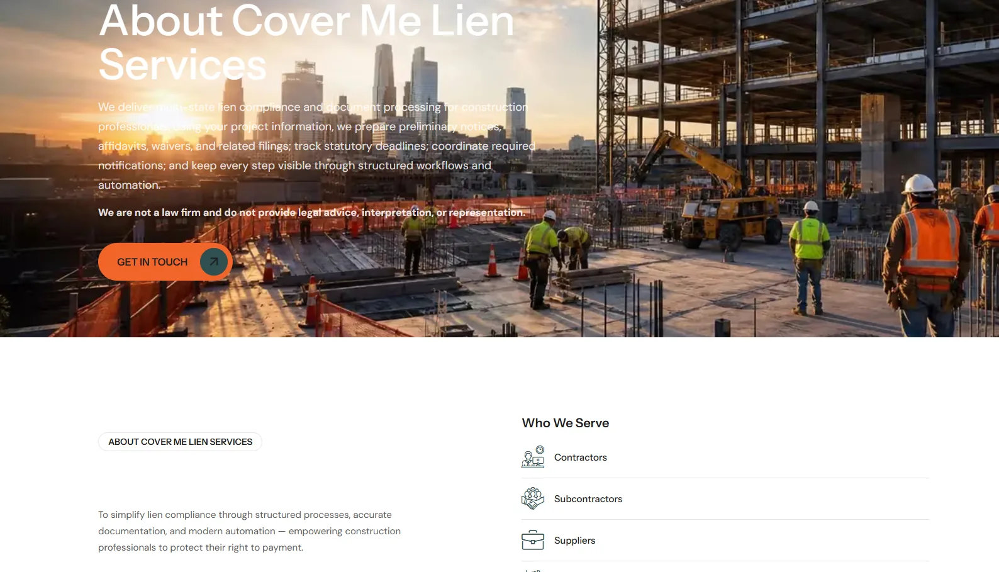 About Cover Me Lien Services</td>
</tr>
</table>

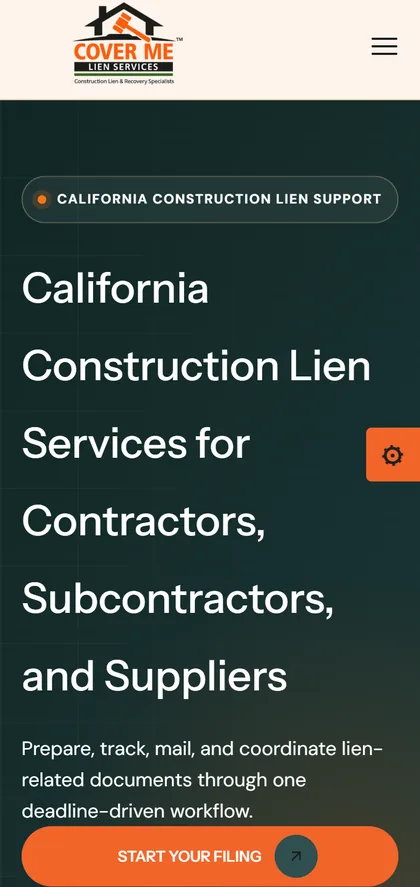 Mobile

## About the developer

Designed, built and deployed by **[Shair Ali](https://shairali.com)**, a full-stack developer who owns products end to end: architecture, interface, API, data, payments, servers and CI/CD.

   

Have a similar project? [Get in touch](https://shairali.com/contact).
